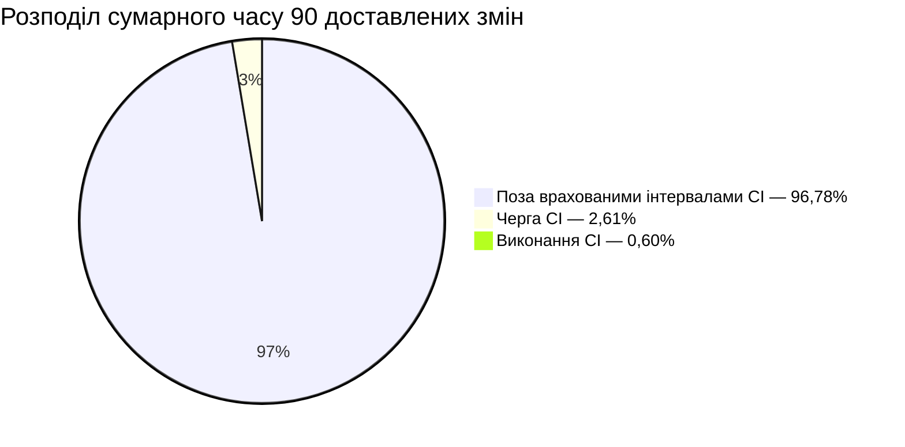

# Метрики доставки YourPathUkma

Джерело — [90 завершених запусків основного workflow CI на `main`](metrics-raw.md). Для частоти використано тритижневе вікно від 23.10.2026 00:00 UTC до 13.11.2026 00:00 UTC (верхня межа виключна). Усі 90 запусків вибірки потрапили в це вікно. З них 88 успішних і 2 невдалі. Часові мітки, SHA, зв’язки з PR і посилання на журнали збоїв є в [JSON-експорті](evidence/main-ci-runs.json).

За визначенням лабораторної зелений запуск на `main` зараховується як розгортання. Тому наведені числа є **наближенням до метрик DORA** за історією CI. У [звіті DORA 2025](https://dora.dev/research/2025/dora-report/) метрики стосуються розгортань у робоче середовище. Відсоток у категорії — частка опитаних із таким самим або кращим рівнем (рис. 11–14).

## Чотири метрики

| Метрика | Розрахунок | Результат | Категорія DORA 2025 |
| --- | --- | --- | --- |
| Частота розгортань | 88 зелених запусків ÷ 3 тижні | **29,33 на тиждень** (4,19 на день) | На вимогу (кілька разів на день) — **16,2%**, за середньою частотою CI |
| Час виконання змін | Від першого коміту PR або від прямого коміту до завершення першого зеленого CI на `main`, який містить зміну, 90 інтервалів | Середнє **13 год 54 хв 19 с**, медіана **8 год 27 хв 15 с** | Менше доби — **24,4%** за середнім і медіаною |
| Частота збоїв змін | 2 червоні ÷ 90 завершених × 100% | **2,22%** | Від 2% до 4% — **16,7%** |
| Час відновлення після невдалого розгортання | Від завершення кожного червоного запуску до завершення наступного зеленого | Середнє й медіана **2 хв 4 с** (2,07 хв) | Менше години — **21,3%** |

### Графік для дашборду DORA

Джерело — [актуальний JSON метрик](dora-metrics.json). Розміри секторів обчислено з точних тривалостей у секундах (разом 4 505 342 с), підписи округлено до сотих відсотка. Це розподіл сумарного часу 90 змін, а не кількості запусків чи часу роботи раннерів. Методика об’єднання інтервалів наведена в розділі «Частки черги та виконання».

**Ключовий висновок:** 96,78% сумарного часу змін минає поза врахованими інтервалами CI; черга й виконання разом займають 3,22%. Додатковий аналіз 82 PR показав, що найбільший етап перед злиттям — після першого рев’ю людини; він охоплює і виправлення, і очікування, тому причину слід уточнювати за історією PR. Водночас 29,33 зеленого запуску на тиждень поєднуються з 2,22% невдалих запусків і медіаною відновлення 2 хв 4 с; оцінка відновлення спирається лише на два збої.

Для часу виконання змін використано 82 зміни зі злитих PR і вісім прямих релізних комітів. Для прямих комітів відлік починається з часу авторства цього коміту. Для PR #210 і #211, чиї власні CI завершилися невдало, інтервал закінчується наступним зеленим запуском коміту `8975b66`: обидва коміти злиття є його предками в Git.

Час виконання змін — це весь час від першого коміту PR або прямого коміту до завершення відповідного зеленого CI на `main`. До нього може входити подальше написання коду після першого коміту, локальне тестування, очікування рев’ю, виправлення за зауваженнями, очікування злиття, а після злиття — черга та виконання CI. Робота до першого коміту лежить поза межами виміру. Медіана **8 год 27 хв 15 с** стосується всього цього інтервалу.

Після невдалих запусків від [PR #210](https://github.com/ukma-fin-ssdm-2026/YourPathUkma/actions/runs/42471622232) і [PR #211](https://github.com/ukma-fin-ssdm-2026/YourPathUkma/actions/runs/42471770242) наступним зеленим за часом завершення був [той самий запуск автоматичного релізного коміту](https://github.com/ukma-fin-ssdm-2026/YourPathUkma/actions/runs/42471841555). Інтервали становили **3 хв 31 с** і **37 с**. Це два виміри до повернення CI в зелений стан після збоїв HTTP 504 на кроці завантаження Python. Вибірка для цієї метрики обмежується цими двома збоями.

### Перевірка формул і категорій за Lab10 — 16.11.2026

Формули й категорії звірено зі сторінками 2–3 та 5–6 Lab10.pdf. Частота 88 ÷ 3 = 29,33 на тиждень, частота збоїв 2 ÷ 90 × 100% = 2,22%, середнє й медіана відновлення (211 + 37) ÷ 2 = 124 с підтверджені. Категорії часу змін (< доби, 24,4%), збоїв (2–4%, 16,7%) та відновлення (< години, 21,3%) відповідають таблиці лабораторної. Категорію частоти «на вимогу» наведено лише як наближення за середньою кількістю CI: готовність до розгортання на вимогу ці дані самі по собі не доводять.

**Виправлено автоматичний підрахунок.** Скрипт збирає час першого коміту для всіх змін і шукає найраніше зелене завершення, SHA якого містить зміну. Перевірка через GitHub Compare API приймає лише `ahead` або `identical`; сам порядок запусків не доводить спорідненість комітів. Повторні спроби одного SHA дають один інтервал часу зміни; зміни без зеленого нащадка в межах вибірки перелічено в `undelivered_change_shas` і не зараховано як доставлені.

До вибірки додано PR #210 і #211 (82 652 с і 46 458 с). Крім того, для PR #154 і #250 перший зелений нащадок завершився раніше за власний зелений CI; ці два інтервали разом скоротилися на 84 с. Для 90 змін сума часу становить **4 505 342 с**, середнє — **50 059,36 с**, медіана — **30 434,5 с**. Категорія «менше доби» зберігається.

Оновлений [JSON](dora-metrics.json) відтворено локально зі збережених метаданих і перевірок предків у Git, без нового збору API. До [доказів](evidence/main-ci-runs.json) додано батьківські SHA всіх 90 комітів; регресійний тест відтворює перевірку предків і всі агрегати без мережі. Масив `lead_time_changes` містить джерело й зелений запуск доставки для кожної зміни.

## Історичні рівні DORA 2024

У DORA 2024 рівні Elite, High, Medium і Low отримали кластерним аналізом відповідей за чотирма метриками. У таблиці наведено типові значення для кожної групи та її частку серед опитаних 2024 року. [Звіт DORA 2024, с. 13](https://dora.dev/research/2024/dora-report/2024-dora-accelerate-state-of-devops-report.pdf#page=13)

| Рівень | Частота розгортань | Час виконання змін | Частота збоїв | Час відновлення | Частка опитаних |
| --- | --- | --- | ---: | --- | ---: |
| Elite | На вимогу, кілька разів на день | Менше доби | 5% | Менше години | 19% |
| High | Від разу на день до разу на тиждень | Від доби до тижня | 20% | Менше доби | 22% |
| Medium | Від разу на тиждень до разу на місяць | Від тижня до місяця | 10% | Менше доби | 35% |
| Low | Від разу на місяць до разу на пів року | Від місяця до пів року | 40% | Від тижня до місяця | 25% |

### Оцінка метрик YourPathUkma

| Метрика | Наш результат | Орієнтир Elite у DORA 2024 | Оцінка за даними CI |
| --- | --- | --- | --- |
| Частота розгортань | 29,33 на тиждень, або 4,19 на день | Кілька разів на день на вимогу | **Elite за частотою.** Можливість розгортання на вимогу за цими даними не визначали. |
| Час виконання змін | Медіана 8 год 27 хв 15 с, середнє 13 год 54 хв 19 с | Менше доби | **Elite.** Обидва значення вкладаються в добу. |
| Частота збоїв | 2,22% (2 з 90 запусків) | 5% — типове значення кластера | **Нижча за типовий показник Elite** на 2,78 відсоткового пункта. |
| Час відновлення | Медіана й середнє 2 хв 4 с | Менше години | **Elite за часом повернення CI до зеленого стану.** Оцінка ґрунтується на двох збоях. |

**Найближчий історичний профіль YourPathUkma за даними CI — Elite.** Це орієнтовне зіставлення для лабораторної. Для оцінки доставки в продакшен потрібні дані фактичних розгортань і відновлення сервісу.

## Частки черги та виконання для 90 доставлених змін

Для кожної зміни враховано запуски її SHA та зелений запуск, що першим доставив її. Інтервали обмежено часом від авторства до доставки; перекриття об’єднано. Якщо черга одного запуску збігається з виконанням іншого, цей час належить виконанню. Решта часу охоплює роботу до CI та паузи між запусками. Виконання workflow вимірюється від першого завдання до останнього, як у сирій таблиці, й може містити паузи між завданнями.

Суми зважено за інтервалами змін: один зелений запуск може доставити кілька змін і входити до кожного з їхніх інтервалів. Це частки часу змін, а не витрати раннера. Для всіх складових знаменник однаковий — 4 505 342 с.

| Складова | Сума, с | Частка загального часу змін |
| --- | ---: | ---: |
| Решта часу поза врахованими інтервалами CI | 4 360 354 | 96,78% |
| Черга CI | 117 740 | **2,61%** |
| Виконання CI | 27 248 | **0,60%** |
| Усього | 4 505 342 | 100,00% |

Сума округлених часток може відрізнятися від 100% на 0,01 відсоткового пункта.

## Уточнення часу поза CI за історією PR

Через GitHub GraphQL API зібрано часові мітки відкриття, формальних рев’ю та злиття **всіх 82 PR** із вибірки. Дані перевірено за SHA злиття; рев’ю ботів виключено. Вісім прямих релізних комітів у цьому розкладі не враховано. Знаменник нижче — **4 502 961 с** сумарного часу 82 змін із PR, тому ці частки не слід додавати до часток CI для 90 змін.

| Етап | Частка часу 82 змін із PR |
| --- | ---: |
| Початок виміру → відкриття PR | 16,37% |
| Відкриття → перше рев’ю людини | 18,63% |
| Перше рев’ю людини → злиття | **61,72%** |
| Відкриття → злиття без формального рев’ю людини | 0,10% |
| Злиття → перший зелений CI зі зміною | 3,17% |

**Висновок:** найбільший виміряний етап — від першого рев’ю людини до злиття. Він може включати виправлення, повторні рев’ю й очікування злиття; причину затримки цими мітками не встановлено. У PR #225 і #226 формального рев’ю людини до злиття немає. Для PR #157 події, що передують початку виміру, обрізано на його межі без зміни сирих міток. Сума округлених часток — 99,99%.

Історію п’яти найдовших PR розібрано: вони дають **45,74%** сумарного часу після першого рев’ю. У #131 зафіксовано **98 год 48 хв 40 с у чернетці**; у #171 і #236 після схвалення тривали зміни та повторні перевірки; #170 злили через **80 с** після фінального основного CI; у #168 після першого схвалення нових комітів немає, але злиття відбулося через **53 год 33 хв 18 с**. Причини всіх проміжків не встановлено, тому 61,72% не слід називати чистим очікуванням рев’ю чи злиття.

Пропозиції за результатами: окремо діагностувати час чернетки, визначити супровід схвалених PR до злиття та повторно переглядати суттєві зміни після схвалення. Це рекомендації; правила репозиторію не змінювалися. [Події й витяги журналів п’яти PR](evidence/pr-history.json). [Повний аналіз і таблиця 82 PR](pr-timing-analysis.md) · [JSON-докази](evidence/pr-timings.json).

## Порівняння з телеметрією CircleCI

Рекомендовані орієнтири наведено у [State of Software Delivery 2025](https://circleci.com/landing-pages/assets/2025-state-of-software-delivery-report.pdf). Фактичні значення за 2025 рік опубліковано у [State of Software Delivery 2026](https://circleci.com/landing-pages/assets/2026-state-of-software-delivery-report.pdf).

| Показник | YourPathUkma | Рекомендований орієнтир | Фактичне значення за 2025 рік |
| --- | ---: | ---: | ---: |
| Частка успішних запусків на `main` | **97,78%** | 90% | 70,8% |
| Повернення `main` до зеленого стану, медіана | **2,07 хв** | До 60 хв | 59,2 хв |
| Тривалість виконання workflow, медіана без черги | **2,68 хв** | До 10 хв | 2,2 хв |

Найбільша частка часу змін лежить поза врахованими інтервалами CI (96,78%): до запусків або між ними. Цей залишок не можна автоматично назвати очікуванням рев’ю. Додатковий розклад за зібраними мітками PR наведено вище; щоб відокремити виправлення від очікування, потрібен перегляд історії конкретних PR.

## Використання ШІ

Codex узагальнив історію п’яти найдовших PR після першого рев’ю. Перевірка: GitHub API, повні сторінки подій і checks, журнали чотирьох невдалих завдань, зіставлення SHA й перерахунок часових інтервалів; факти відокремлено від непідтверджених причин.

Codex зібрав метадані 82 PR через GitHub API й додав розклад етапів доставки. Перевірка: усі SHA зіставлено, пагінація рев’ю повна, сума невід’ємних складових кожного PR збігається з поточним JSON метрик; окремо враховано два PR без формального рев’ю й один PR із подіями до початку виміру.

Codex додав Mermaid-графік розподілу часу змін і висновок для дашборду. Перевірка: значення секторів і відсотки звірено з `dora-metrics.json`, перевірено суму складових та формат Markdown; рендер Mermaid окремо не перевірявся.

Codex виправив автоматизацію, повторно сформував JSON і оновив частки часу для 90 змін. Перевірка: 16 тестів pytest, Ruff, перевірка предків Git і незалежна перевірка об’єднання інтервалів за збереженими доказами.

Codex перевірив формули й категорії за Lab10.pdf, виявив два пропущені інтервали часу змін і виправив основну таблицю. Перевірка: незалежний перерахунок за JSON-доказами та підтвердження спорідненості комітів через Git; історичні обмеження та їх виправлення зазначено окремо.

Codex обчислив метрики з метаданих GitHub Actions і PR та підготував звіт. Кількість запусків і часові інтервали звірено з таблицею сирих даних. Пороги категорій і значення для порівняння перевірено за звітами DORA та CircleCI.

Codex уточнив, які етапи може охоплювати час виконання змін. Межі інтервалу звірено з формулою в таблиці.

Codex додав історичні рівні й окремо оцінив кожну метрику CI проєкту. Значення звірено з таблицею груп у звіті DORA 2024 і розрахунками вище.

Codex додав JSON-докази, оновив розрахунок із вісьмома прямими релізними комітами й підготував розділ про бонуси. Усі 90 ID звірено з таблицею, 88 інтервалів і частки часу перераховано за точними мітками, історію спроб перевірено через GitHub Actions API.

## Бонуси

**№1. Автоматичний підрахунок метрик.** Історичний результат до виправлення: ручний workflow успішно відтворив історичну вибірку Лаб 10. JSON із запуску на гілці виправлення #263 збігся зі збереженим звітом для всіх 90 запусків. Частота становить 29,33 зеленого запуску на тиждень, частота збоїв — 2,22%. Медіана часу змін становить 6 год 37 хв 46 с, а відновлення — 2 хв 4 с. Черга займає 2,69% сумарного часу змін, виконання — 0,61%. Перший ручний розрахунок охоплював 80 інтервалів. Після включення восьми прямих релізних комітів вибірка часу змін містить 88 інтервалів. [Інструкція запуску](dora-metrics.md) · [Успішний запуск](https://github.com/ukma-fin-ssdm-2026/YourPathUkma/actions/runs/43634166809) · [JSON-артефакт](https://github.com/ukma-fin-ssdm-2026/YourPathUkma/actions/runs/43634166809/artifacts/14129461035) · [Збережений JSON](dora-metrics.json)

Поточний локально перевірений результат після виправлення: **90 інтервалів**, середнє 13 год 54 хв 19 с, медіана 8 год 27 хв 15 с, черга 2,61%, виконання 0,60%. Старий артефакт workflow за посиланням вище містить попередній алгоритм; новий запуск workflow ще не виконувався.

**№4. Пошук нестабільних тестів.** У контрольному запуску на `main` один раннер виконав п’ять раундів на одному коміті. У звітах зафіксовано 494 бекенд-тести й 479 фронтенд-тестів. Змінних результатів, стабільних падінь і неповних раундів не виявлено. За період етапу 1 усі 90 запусків CI на `main` мали `attempt=1`, тому список запусків, що стали зеленими після повторної спроби на тому самому SHA, порожній. [Контрольний запуск на main](https://github.com/ukma-fin-ssdm-2026/YourPathUkma/actions/runs/43632395606) · [JUnit і підсумок](https://github.com/ukma-fin-ssdm-2026/YourPathUkma/actions/runs/43632395606/artifacts/14128598845)

У демонстраційному Draft PR #262 додано тест, який навмисно падає у другому й четвертому раундах. Детектор зафіксував обидва результати, `failed` і `passed`. GitHub позначив прогін як `failure` на кроці порівняння. Усі п’ять раундів завершилися й опублікували 10 JUnit-звітів. [Демонстраційний PR](https://github.com/ukma-fin-ssdm-2026/YourPathUkma/pull/262) · [Демонстраційний запуск](https://github.com/ukma-fin-ssdm-2026/YourPathUkma/actions/runs/43633781179) · [JUnit і підсумок](https://github.com/ukma-fin-ssdm-2026/YourPathUkma/actions/runs/43633781179/artifacts/14129381666)

Владислав Смирнов — [відео Лаб 10](https://www.loom.com/share/efd06a78b4bb44aab7824720fc3b19ae). Посилання для здачі є у [файлі Labs/Lab10](../../Labs/Lab10/video_Vladyslav.txt).

**Використання ШІ.** Codex оновив розділ. Статуси запусків і вміст артефактів звірено з GitHub Actions та збереженим звітом. Codex також записав надане Владиславом посилання у файл здачі й звірив збіг URL у звіті, файлі та описі PR.

**Використання ШІ.** Codex оновив назви файлів та посилання після перейменування метрик DORA. Перевірка: пошук застарілих назв і регресійні тести.

**№5. Артефакт випуску — підготовлено, очікує доказів із main.** Додано образ API та workflow `Publish container`: після зеленого push-CI на `main` він перевіряє запуск образу й публікує його в GHCR із повним SHA коміту. Скрипт `python -m scripts.container_metrics` обчислює чотири метрики для спільного періоду за двома визначеннями: зелений CI та успішна публікація образу. [Реалізація, методика й команда запуску](container-release.md). Для завершення бонусу після злиття потрібні фактична таблиця порівняння, посилання на успішний запуск і пакет, а також пояснення у відео. Історичну вибірку без образів не зараховано як публікації GHCR.

**Використання ШІ.** Codex додав опис підготовки бонусу №5. Алгоритм перевірено тестами, Python-код — Ruff; статус відокремлено від ще не отриманих доказів GHCR.
