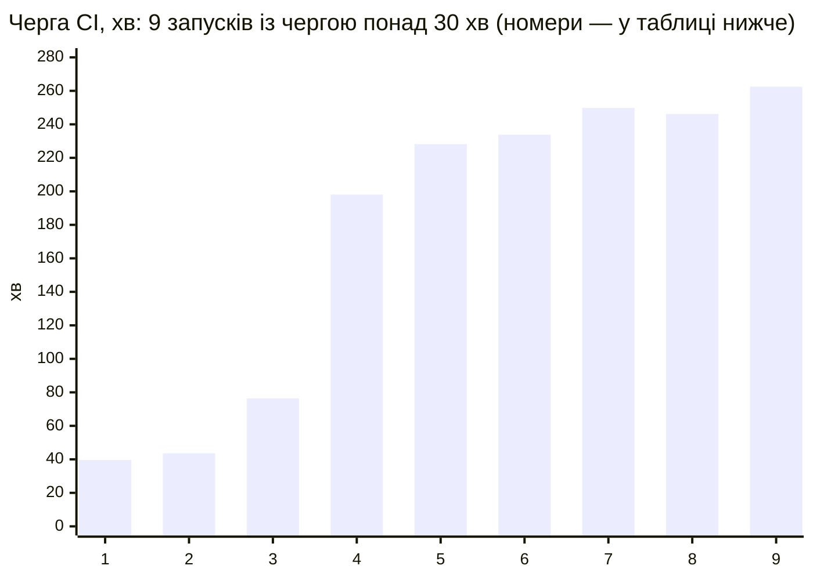
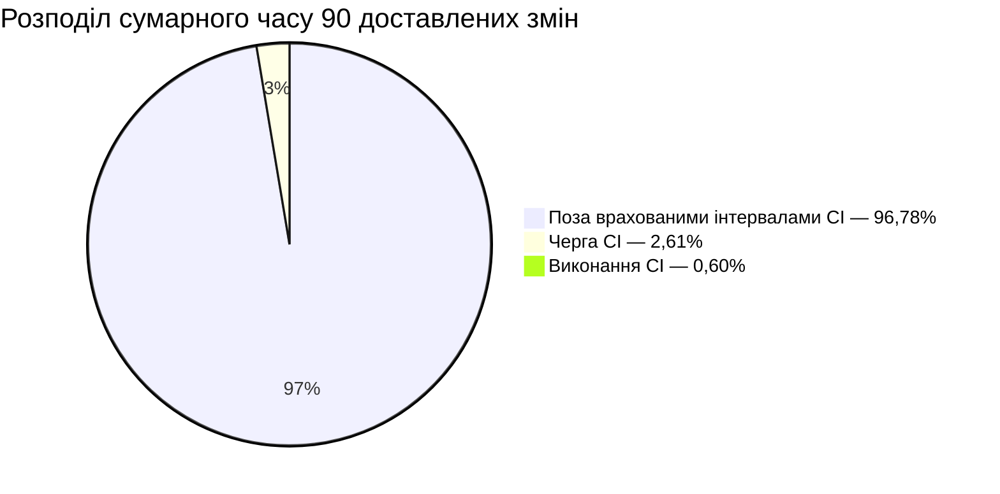

# Метрики доставки YourPathUkma

Джерело — [90 завершених запусків основного workflow CI на `main`](metrics-raw.md). Для частоти використано тритижневе вікно від 23.10.2026 00:00 UTC до 13.11.2026 00:00 UTC (верхня межа виключна). Усі 90 запусків вибірки потрапили в це вікно. З них 88 успішних і 2 невдалі. Часові мітки, SHA, зв’язки з PR і посилання на журнали збоїв є в [JSON-експорті](evidence/main-ci-runs.json).

За визначенням лабораторної зелений запуск на `main` зараховується як розгортання. Тому наведені числа є **наближенням до метрик DORA** за історією CI. У [звіті DORA 2025](https://dora.dev/research/2025/dora-report/) метрики стосуються розгортань у робоче середовище. Відсоток у категорії — частка опитаних із таким самим або кращим рівнем (рис. 11–14).

## Визначення розгортання і враховані workflow

- **Розгортання** — успішний (зелений) запуск workflow `CI` ([`ci.yaml`](../../.github/workflows/ci.yaml)) після push у `main`. Застосунок у production команда не розгортає, тому це наближення за безперервною доставкою.
- **Невдала зміна** — червоний запуск `CI` на `main`; червоні запуски в PR не рахуються.
- **Врахований workflow:** лише `CI`. Один запуск `CI` складається з завдань `build` (ruff, bandit, перевірка OpenAPI, pytest з покриттям ≥ 80%) і `frontend` (npm audit, lint, typecheck, Vitest, build); запуск зелений, лише коли зелені обидва. Інші workflow на `main` (`Reliability`, `Publish container`, `DORA metrics`, `Flaky tests`, `Release`, `Deploy API docs`) у метриках не враховано. Публікацію образу окремо розглянуто в бонусі №5.
- **Час виконання змін** — від першого коміту PR (для прямого коміту — від самого коміту) до завершення першого зеленого `CI` на `main`, що містить зміну. **Черга** — від `createdAt` запуску до найранішого `startedAt` його завдань; **виконання** — від цього моменту до найпізнішого `completedAt`.
- Автоматичні релізні коміти (`chore(release)`) надсилає бот прямо в `main`; їх включено в вибірку (8 із 90 запусків).

## Дашборд DORA

| Метрика | Результат | Рівень за DORA 2025 | Що за цим стоїть |
| --- | --- | --- | --- |
| Частота розгортань | **29,33 на тиждень** (88 зелених із 90) | на вимогу, 16,2% | зливаємо щодня, але 8 із 90 запусків — автоматичні релізні коміти бота |
| Час виконання змін | медіана **8 год 27 хв**, середнє 13 год 54 хв | менше доби, 24,4% | 96,78% часу минає поза CI; найбільший етап — від першого рев'ю до злиття (61,72%) |
| Частота збоїв змін | **2,22%** (2 із 90) | 2–4%, 16,7% | обидва збої — HTTP 504 на `setup-python`, не дефект коду |
| Час відновлення | медіана **2 хв 4 с** | менше години, 21,3% | відновлення — від наступного зеленого коміту; вибірка з двох збоїв |

| № | Коміт | PR | Створено (Київ) | Черга, хв |
| --: | --- | --: | --- | --: |
| 1 | `091e7e3` | #165 | 30.10 00:22 | 39,6 |
| 2 | `043664d` | #178 | 01.11 22:21 | 43,6 |
| 3 | `b9112c2` | #171 | 01.11 22:21 | 76,4 |
| 4 | `7376c2e` | #180 | 01.11 23:26 | 198,1 |
| 5 | `0005543` | #181 | 01.11 23:26 | 228,2 |
| 6 | `f40b6db` | #182 | 01.11 23:26 | 233,8 |
| 7 | `bc10763` | #183 | 01.11 23:27 | 249,8 |
| 8 | `bef8409` | #184 | 01.11 23:38 | 246,2 |
| 9 | `8bdc115` | #185 | 01.11 23:40 | 262,5 |

Джерело — `queue` = від `created_at` запуску до найранішого `started_at` його завдань, за [JSON-доказами](evidence/main-ci-runs.json); час переведено в Київ (UTC+2).

**Ключовий висновок.** Ми зливаємо в `main` майже щодня, і CI після злиття швидкий й стабільний (медіана виконання 2,68 хв, 97,78% зелених запусків). Тому час виконання змін майже не залежить від CI: 96,78% його йде до запуску або між запусками, а 61,72% часу PR — після першого рев'ю. Черга на спільних раннерах проявляється гостро, але рідко: 9 із 90 запусків чекали понад 30 хв; вісім із них припадають на вечір 1 листопада перед дедлайном, і шість чекали від 3 год 18 хв до 4 год 22 хв. П'ять найдовших черг дають 62% усіх хвилин черги; медіана черги лише 1,14 хв, а середня — 21,8 хв.

**Одна дія до наступного тижня.** Увімкнути в репозиторії auto-merge і домовитися, що схвалений PR зливається протягом 2 годин (відповідальний — супроводжувач репозиторію, Данило). Метрика успіху: частка часу «від першого рев'ю до злиття» у наступних PR, [розрахунок за `pr-timing-analysis.md`](pr-timing-analysis.md).

## Чотири метрики

| Метрика | Розрахунок | Результат | Категорія DORA 2025 |
| --- | --- | --- | --- |
| Частота розгортань | 88 зелених запусків ÷ 3 тижні | **29,33 на тиждень** (4,19 на день) | На вимогу (кілька разів на день) — **16,2%**, за середньою частотою CI |
| Час виконання змін | Від першого коміту PR або від прямого коміту до завершення першого зеленого CI на `main`, який містить зміну, 90 інтервалів | Середнє **13 год 54 хв 19 с**, медіана **8 год 27 хв 15 с** | Менше доби — **24,4%** за середнім і медіаною |
| Частота збоїв змін | 2 червоні ÷ 90 завершених × 100% | **2,22%** | Від 2% до 4% — **16,7%** |
| Час відновлення після невдалого розгортання | Від завершення кожного червоного запуску до завершення наступного зеленого | Середнє й медіана **2 хв 4 с** (2,07 хв) | Менше години — **21,3%** |

### Графік для дашборду DORA

Джерело — [актуальний JSON метрик](dora-metrics.json). Розміри секторів обчислено з точних тривалостей у секундах (разом 4 505 342 с), підписи округлено до сотих відсотка. Це розподіл сумарного часу 90 змін, а не кількості запусків чи часу роботи раннерів. Методика об’єднання інтервалів наведена в розділі «Частки черги та виконання».

**Ключовий висновок:** 96,78% сумарного часу змін минає поза врахованими інтервалами CI; черга й виконання разом займають 3,22%. Додатковий аналіз 82 PR показав, що найбільший етап перед злиттям — після першого рев’ю людини; він охоплює і виправлення, і очікування, тому причину слід уточнювати за історією PR. Водночас 29,33 зеленого запуску на тиждень поєднуються з 2,22% невдалих запусків і медіаною відновлення 2 хв 4 с; оцінка відновлення спирається лише на два збої.

Для часу виконання змін використано 82 зміни зі злитих PR і вісім прямих релізних комітів. Для прях комітів відлік починається з часу авторства цього коміту. Для PR #210 і #211, чиї власні CI завершилися невдало, інтервал закінчується наступним зеленим запуском коміту `8975b66`: обидва коміти злиття є його предками в Git.

Час виконання змін — це весь час від першого коміту PR або прямого коміту до завершення відповідного зеленого CI на `main`. До нього може входити подальше написання коду після першого коміту, локальне тестування, очікування рев’ю, виправлення за зауваженнями, очікування злиття, а після злиття — черга та виконання CI. Робота до першого коміту лежить поза межами виміру. Медіана **8 год 27 хв 15 с** стосується всього цього інтервалу.

Після невдалих запусків від [PR #210](https://github.com/ukma-fin-ssdm-2026/YourPathUkma/actions/runs/42471622232) і [PR #211](https://github.com/ukma-fin-ssdm-2026/YourPathUkma/actions/runs/42471770242) наступним зеленим за часом завершення був [той самий запуск автоматичного релізного коміту](https://github.com/ukma-fin-ssdm-2026/YourPathUkma/actions/runs/42471841555). Інтервали становили **3 хв 31 с** і **37 с**. Це два виміри до повернення CI в зелений стан після збоїв HTTP 504 на кроці завантаження Python. Вибірка для цієї метрики обмежується цими двома збоями.

### Перевірка формул і категорій за Lab10 — 16.11.2026

Формули й категорії звірено зі сторінками 2–3 та 5–6 Lab10.pdf. Частота 88 ÷ 3 = 29,33 на тиждень, частота збоїв 2 ÷ 90 × 100% = 2,22%, середнє й медіана відновлення (211 + 37) ÷ 2 = 124 с підтверджені. Категорії часу змін (< доби, 24,4%), збоїв (2–4%, 16,7%) та відновлення (< години, 21,3%) відповідають таблиці лабораторної. Категорію частоти «на вимогу» наведено лише як наближення за середньою кількістю CI: готовність до розгортання на вимогу ці дані самі по собі не доводять.

**Виправлено автоматичний підрахунок.** Скрипт збирає час першого коміту для всіх змін і шукає найраніше зелене завершення, SHA якого містить зміну. Перевірка через GitHub Compare API приймає лише `ahead` або `identical`; сам порядок запусків не доводить спорідненість комітів. Повторні спроби одного SHA дають один інтервал часу зміни; зміни без зеленого нащадка в межах вибірки перелічено в `undelivered_change_shas` і не зараховано як доставлені.

До вибірки додано PR #210 і #211 (82 652 с і 46 458 с). Крім того, для PR #154 і #250 перший зелений нащадок завершився раніше за власний зелений CI; ці два інтервали разом скоротилися на 84 с. Для 90 змін сума часу становить **4 505 342 с**, середнє — **50 059,36 с**, медіана — **30 434,5 с**. Категорія «менше доби» зберігається.

Оновлений [JSON](dora-metrics.json) відтворено локально зі збережених метаданих і перевірок предків у Git, без нового збору API. До [доказів](evidence/main-ci-runs.json) додано батьківські SHA всіх 90 комітів; регресійний тест відтворює перевірку предків і всі агрегати без мережі. Масив `lead_time_changes` містить джерело й зелений запуск доставки для кожної зміни.

## Історичні рівні DORA 2024

У DORA 2024 рівні Elite, High, Medium і Low отримали кластерним аналізом відповідей за чотирма метриками. У таблиці наведено типові значення для кожної групи та її частку серед опитаних 2024 року. [Звіт DORA 2024, с. 13](https://dora.dev/research/2024/dora-report/2024-dora-accelerate-state-of-devops-report.pdf#page=13)

| Рівень | Частота розгортань | Час виконання змін | Частота збоїв | Час відновлення | Частка опитаних |
| --- | --- | --- | ---: | --- | ---: |
| Elite | На вимогу, кілька разів на день | Менше доби | 5% | Менше години | 19% |
| High | Від разу на день до разу на тиждень | Від доби до тижня | 20% | Менше доби | 22% |
| Medium | Від разу на тиждень до разу на місяць | Від тижня до місяця | 10% | Менше доби | 35% |
| Low | Від разу на місяць до разу на пів року | Від місяця до пів року | 40% | Від тижня до місяця | 25% |

### Оцінка метрик YourPathUkma

| Метрика | Наш результат | Орієнтир Elite у DORA 2024 | Оцінка за даними CI |
| --- | --- | --- | --- |
| Частота розгортань | 29,33 на тиждень, або 4,19 на день | Кілька разів на день на вимогу | **Elite за частотою.** Можливість розгортання на вимогу за цими даними не визначали. |
| Час виконання змін | Медіана 8 год 27 хв 15 с, середнє 13 год 54 хв 19 с | Менше доби | **Elite.** Обидва значення вкладаються в добу. |
| Частота збоїв | 2,22% (2 з 90 запусків) | 5% — типове значення кластера | **Нижча за типовий показник Elite** на 2,78 відсоткового пункта. |
| Час відновлення | Медіана й середнє 2 хв 4 с | Менше години | **Elite за часом повернення CI до зеленого стану.** Оцінка ґрунтується на двох збоях. |

**Найближчий історичний профіль YourPathUkma за даними CI — Elite.** Це орієнтовне зіставлення для лабораторної. Для оцінки доставки в продакшен потрібні дані фактичних розгортань і відновлення сервісу.

## Частки черги та виконання для 90 доставлених змін

Для кожної зміни враховано запуски її SHA та зелений запуск, що першим доставив її. Інтервали обмежено часом від авторства до доставки; перекриття об’єднано. Якщо черга одного запуску збігається з виконанням іншого, цей час належить виконанню. Решта часу охоплює роботу до CI та паузи між запусками. Виконання workflow вимірюється від першого завдання до останнього, як у сирій таблиці, й може містити паузи між завданнями.

Суми зважено за інтервалами змін: один зелений запуск може доставити кілька змін і входити до кожного з їхніх інтервалів. Це частки часу змін, а не витрати раннера. Для всіх складових знаменник однаковий — 4 505 342 с.

| Складова | Сума, с | Частка загального часу змін |
| --- | ---: | ---: |
| Решта часу поза врахованими інтервалами CI | 4 360 354 | 96,78% |
| Черга CI | 117 740 | **2,61%** |
| Виконання CI | 27 248 | **0,60%** |
| Усього | 4 505 342 | 100,00% |

Сума округлених часток може відрізнятися від 100% на 0,01 відсоткового пункта.

## Уточнення часу поза CI за історією PR

Через GitHub GraphQL API зібрано часові мітки відкриття, формальних рев’ю та злиття **всіх 82 PR** із вибірки. Дані перевірено за SHA злиття; рев’ю ботів виключено. Вісім прямих релізних комітів у цьому розкладі не враховано. Знаменник нижче — **4 502 961 с** сумарного часу 82 змін із PR, тому ці частки не слід додавати до часток CI для 90 змін.

| Етап | Частка часу 82 змін із PR |
| --- | ---: |
| Початок виміру → відкриття PR | 16,37% |
| Відкриття → перше рев’ю людини | 18,63% |
| Перше рев’ю людини → злиття | **61,72%** |
| Відкриття → злиття без формального рев’ю людини | 0,10% |
| Злиття → перший зелений CI зі зміною | 3,17% |

**Висновок:** найбільший виміряний етап — від першого рев’ю людини до злиття. Він може включати виправлення, повторні рев’ю й очікування злиття; причину затримки цими мітками не встановлено. У PR #225 і #226 формального рев’ю людини до злиття немає. Для PR #157 події, що передують початку виміру, обрізано на його межі без зміни сирих міток. Сума округлених часток — 99,99%.

Історію п’яти найдовших PR розібрано: вони дають **45,74%** сумарного часу після першого рев’ю. У #131 зафіксовано **98 год 48 хв 40 с у чернетці**; у #171 і #236 після схвалення тривали зміни та повторні перевірки; #170 злили через **80 с** після фінального основного CI; у #168 після першого схвалення нових комітів немає, але злиття відбулося через **53 год 33 хв 18 с**. Причини всіх проміжків не встановлено, тому 61,72% не слід називати чистим очікуванням рев’ю чи злиття.

Пропозиції за результатами: окремо діагностувати час чернетки, визначити супровід схвалених PR до злиття та повторно переглядати суттєві зміни після схвалення. Це рекомендації; правила репозиторію не змінювалися. [Події й витяги журналів п’яти PR](evidence/pr-history.json). [Повний аналіз і таблиця 82 PR](pr-timing-analysis.md) · [JSON-докази](evidence/pr-timings.json).

## Порівняння з телеметрією CircleCI

Рекомендовані орієнтири наведено у [State of Software Delivery 2025](https://circleci.com/landing-pages/assets/2025-state-of-software-delivery-report.pdf). Фактичні значення за 2025 рік опубліковано у [State of Software Delivery 2026](https://circleci.com/landing-pages/assets/2026-state-of-software-delivery-report.pdf).

| Показник | YourPathUkma | Рекомендований орієнтир | Фактичне значення за 2025 рік |
| --- | ---: | ---: | ---: |
| Частка успішних запусків на `main` | **97,78%** | 90% | 70,8% |
| Повернення `main` до зеленого стану, медіана | **2,07 хв** | До 60 хв | 59,2 хв |
| Тривалість виконання workflow, медіана без черги | **2,68 хв** | До 10 хв | 2,2 хв |

Найбільша частка часу змін лежить поза врахованими інтервалами CI (96,78%): до запусків або між ними. Цей залишок не можна автоматично назвати очікуванням рев’ю. Додатковий розклад за зібраними мітками PR наведено вище; щоб відокремити виправлення від очікування, потрібен перегляд історії конкретних PR.

## Аналіз парами: швидкість разом зі стабільністю

**Пара 1. Частота розгортань × частота збоїв.** 29,33 зеленого запуску на тиждень поєднуються з 2,22% червоних: швидкість не куплена ціною стабільності. Але обережно: 8 із 90 запусків — автоматичні релізні коміти, які не є окремою роботою команди, тож «справжня» частота нижча; обидва збої спричинив зовнішній HTTP 504, а не код, тобто 2,22% не показує, наскільки добре PR відсіюють дефекти коду. Вибірка з двох збоїв замала для висновків про якість тестів.

**Пара 2. Час виконання змін × час відновлення.** Після злиття цикл зворотного зв'язку короткий: медіана виконання CI 2,68 хв, відновлення 2 хв 4 с. Проте медіана часу змін — 8 год 27 хв, а середнє — 13 год 54 хв. Отже, повільна не перевірка, а шлях до злиття: 61,72% часу PR минає після першого рев'ю людини. Розрив між середнім і медіаною показує довгий хвіст (PR #131 провів 98 год 48 хв у чернетці).

**Пара 3. Частота розгортань × час виконання змін.** Часті злиття мали б скорочувати час змін, проте щоденний темп не означає короткий цикл кожної зміни: зміни виходять пакетами. Наприклад, 29.10 сім PR (#149, #151–#156) із першими комітами о 12:23–12:24 доставлено між 22:33 і 22:40 за Києвом, тобто після ≈10 год очікування ([`metrics-raw.md`](metrics-raw.md), рядки 12–18). Одна зміна чекає всю добу, а на графіку частоти це виглядає як сплеск.

**Пара 4. Час відновлення × черга.** Швидке відновлення у 2 хв зумовлене тим, що обидва збої стались у спокійний час. Якби такий збій припав на вечір 1 листопада, відновлення додало б 3–4 год черги, бо повторний запуск стояв би в тій самій черзі.

**Підсумок пар.** Стабільність і швидкість після злиття добрі; вузьке місце лежить у людському процесі до злиття, а черга на спільних раннерах — окремий, рідкісний, але болісний ризик перед дедлайнами.

## Етап 3: Першопричини і план покращень (Improvement Backlog)

Розділ підготовлено в межах ролі «Проєктувальник покращень» (issue #267).

### 1. Аналіз першопричин повільних і червоних запусків

На основі 90 завершених запусків CI на `main` та детального аналізу 82 PR виявлено такі першопричини:

#### 🧩 Технічні першопричини:
1. **Зовнішні інфраструктурні таймаути (100% збоїв на `main`):** обидва червоні запуски з 90 (2,22%) — збої HTTP 504 Gateway Timeout під час кроку `actions/setup-python` при завантаженні двійкового архіву Python 3.12 (запуски [42471622232](https://github.com/ukma-fin-ssdm-2026/YourPathUkma/actions/runs/42471622232) від PR #210 і [42471770242](https://github.com/ukma-fin-ssdm-2026/YourPathUkma/actions/runs/42471770242) від PR #211).
2. **Відсутність механізму повторних спроб (retry) для зовнішніх залежностей:** короткочасний мережевий таймаут CDN стороннього провайдера призводив до повного збою workflow замість автоматичного перезапуску кроку.
3. **Марне завантаження раннерів застарілими збірками (усунено бонусом №2):** до впровадження відсутність налаштування `concurrency` з `cancel-in-progress: true` у `.github/workflows/ci.yaml` змушує self-hosted раннери виконувати повні тести для проміжних комітів у PR, які вже втратили актуальність після нового пушу.
4. **Виконання повного CI для змін, які не зачіпають код (усунено бонусом №2):** до впровадження відсутність `paths-ignore` у PR-тригерах для документації (`docs/**`, `**.md`) призводить до марного прогону тривалих тестів БД і бекенду.

#### 🤝 Організаційні та культурні першопричини:
1. **Затримка злиття після отримання схвалення (Review-to-Merge Lag):** аналіз часових міток показав, що **61,72%** сумарного часу 82 PR минає між першим формальним схваленням людиною та фінальним злиттям. Зокрема, у PR #168 після першого апруву не було жодного нового коміту, проте злиття відбулося лише через **53 год 33 хв**. У PR #171 і #236 після схвалення тривали тривалі повторні цикли доопрацювань і додаткових перевірок.
2. **Тривалий час у статусі чернетки (Draft PR):** у PR #131 зафіксовано **98 год 48 хв у чернетці** до початку активного огляду, що значно спотворює медіану часу доставки змін.
3. **Відсутність чергового конвеєра (Build Cop, §1.8.2):** у команді не було закріпленої особи, відповідальної за моніторинг черги перегляду та оперативне усунення заторів конвеєра.

---

### 2. Огляд інцидентів без пошуку винних (Blameless Postmortem, §4.4.2)

Аналіз двох невдалих запусків на гілці `main`:

| Параметр | Інцидент 1 (PR #210) | Інцидент 2 (PR #211) |
|---|---|---|
| **Запуск на main** | [Run 42471622232](https://github.com/ukma-fin-ssdm-2026/YourPathUkma/actions/runs/42471622232) | [Run 42471770242](https://github.com/ukma-fin-ssdm-2026/YourPathUkma/actions/runs/42471770242) |
| **Симптом** | Помилка на завданні `build` на кроці `Set up Python 3.12` | Помилка на завданні `build` на кроці `Set up Python 3.12` |
| **Першопричина** | HTTP 504 Gateway Timeout при спробі завантаження архіву Python 3.12 із CDN GitHub Actions | Той самий мережевий таймаут HTTP 504 під час паралельного/послідовного запуску |
| **Чому дефект пройшов непоміченим у PR** | У гілках обох PR попередні прогони завершилися успішно раніше, коли мережевий CDN працював штатно. Помилка виникла виключно через часовий збіг інфраструктурного таймауту стороннього сервісу в момент злиття в `main`. |
| **Яку перевірку/захист варто додати** | Додати автоматичні повторні спроби (`retry`) на рівні кроку встановлення середовища, а також кешування tool-cache на раннері. |
| **Час відновлення (MTTR)** | **3 хв 31 с** — наступний комміт автоматичного релізу `8975b66` відновив зелений статус. | **37 с** — відновлено тим самим релізним комітом `8975b66`. |

---

### 3. План покращень (Improvement Backlog)

Для кожної з 4 метрик DORA запропоновано по 2–3 конкретні дії на основі виявлених даних:

| Метрика DORA | Проблема | Першопричина (з даними) | Дія з покращення (Action) | Відповідальний |
|---|---|---|---|---|
| **Час виконання змін (Lead Time)** | Затримка злиття після схвалення рев'ювером | 61,72% часу 82 PR минає між першим схваленням і злиттям (до 53,5 год у #168) | **Дія 1.1:** Запровадити командний регламент: після отримання схвалення PR має зливатися протягом ≤ 2 годин. | Tech Lead / Reviewer |
| **Час виконання змін (Lead Time)** | Зависання відкритих чернеток | PR #131 перебував 98,8 год у статусі Draft до активної роботи | **Дія 1.2:** Відкривати PR лише у стані `Ready for review`; великі задачі дробити на менші PR (до 300 рядків). | Усі розробники |
| **Час виконання змін (Lead Time)** | Ручне злиття та очікування повторного кліку | 96,78% часу проходить поза CI через ручні паузи | **Дія 1.3:** Увімкнути функціонал GitHub `auto-merge`, щоб схвалений PR зливався одразу після завершення checks. | Адміністратор репозиторію |
| **Частота збоїв змін (CFR)** | Червоні запуски через мережеві таймаути | 2 з 90 запусків (2,22%) впали через HTTP 504 при `setup-python` | **Дія 2.1:** Додати автоматичний retry для завантаження середовища та залежностей у `.github/workflows/ci.yaml`. | DevOps / CI інженер |
| **Частота збоїв змін (CFR)** | Ризик злиття застарілих гілок | Запуски PR проходили на старішому базовому коміті, ніж поточний `main` | **Дія 2.2:** Увімкнути правило branch protection `Require branches to be up to date before merging` або Merge Queue. | Адміністратор репозиторію |
| **Час відновлення (MTTR)** | Відсутність оперативного моніторингу конвеєра | Ризик затримки реакції команди у разі реального дефекту в коді | **Дія 3.1:** Впровадити щотижневу чергову роль **Build Cop (§1.8.2)**, відповідальну за негайне лагодження збірок `main` (<15 хв). | Ротація в команді |
| **Час відновлення (MTTR)** | Ручний пошук коміту, що зламав збірку | Витрата часу на аналіз історії при падіннях | **Дія 3.2:** Забезпечити регламент та шаблон швидкого відкату (one-click revert PR) без тривалого налагодження безпосередньо в `main`. | Build Cop / Автор PR |
| **Частота розгортань (DF)** | Черга на спільних self-hosted раннерах | Застарілі запуски в PR та збірки для doc-only змін займають раннери | **Дія 4.1 (виконано, бонус №2):** Додати `concurrency` з `cancel-in-progress: true` для PR та `paths-ignore` для документації. | DevOps / CI інженер |
| **Частота розгортань (DF)** | Повільне повторне встановлення залежностей | До впровадження залежності завантажувалися щоразу наново | **Дія 4.2 (виконано):** кешування pip між запусками — `cache: pip` в `actions/setup-python` у `ci.yaml`. | DevOps / CI інженер |

---

### 4. Пріоритетна дія на наступний тиждень

**Обрана дія:** **увімкнути GitHub auto-merge і домовитися зливати схвалений PR протягом 2 годин (Дія 1.1 і 1.3).**
- **Обґрунтування:** `concurrency` і `paths-ignore` уже впроваджено (бонус №2), тож найбільший невикористаний резерв — етап від першого рев'ю до злиття (61,72% часу PR; у PR #168 — 53 год 33 хв після схвалення без нових комітів).
- **Другий пріоритет:** retry для кроку встановлення Python (Дія 2.1), бо обидва червоні запуски на `main` — HTTP 504 на `setup-python`.
- **Як виміряємо:** частка етапу «перше рев'ю → злиття» і медіана часу змін для PR, злитих після впровадження.

---

## Який біль у нашій команді показали ці метрики?

| Метрика | Біль, який вона показала | Докази |
| --- | --- | --- |
| Частота розгортань | зміни виходять пакетами; бот додає шум до підрахунку | сім PR доставлено за 7 хв 29.10 після ≈10 год очікування; 8 із 90 запусків — релізний бот |
| Час виконання змін | написаний код днями не доходить до `main`: PR очікують рев'ю, злиття або стоять у чернетці | 61,72% часу PR після першого рев'ю; #131 — 98 год 48 хв у чернетці; #168 — 53 год 33 хв від схвалення до злиття |
| Частота збоїв змін | `main` ламає не наш код, а зовнішня інфраструктура; команда не має захисту від таких збоїв | 2 із 2 червоних запусків — HTTP 504 на `setup-python` |
| Час відновлення | сьогодні відновлення швидке, але залежить від того, що наступний коміт прийде за хвилини | 211 с і 37 с; відновлював автоматичний релізний коміт `8975b66`, а не людина |
| Черга (частина часу виконання) | перед дедлайном спільні раннери стають вузьким місцем для всіх команд | вісім із дев'яти довгих черг — вечір 1 листопада, до 4 год 22 хв |

**Висновок про проблему команди.** Наш конвеєр не повільний і не крихкий: після злиття він працює за кілька хвилин. Біль лежить у процесі навколо нього: зміни довго чекають людей (рев'ю, злиття, зняття чернетки) і зливаються пакетами, а перед дедлайном ще й упираються в спільну чергу раннерів. Метрики призначені для покращення процесу, а не для оцінювання людей: за PR #131 чи #168 не слід шукати винного, а варто визначити відповідальність за супровід схвалених PR (§1.8.2).

## Використання ШІ

Покращення конвеєра з виміряним ефектом за допомогою concurrency та paths-ignore та таблицю «до і після» за допомогою Antigravity (Google DeepMind). Перевірка: налаштування workflows перевірено валідатором синтаксису GitHub Actions, часи запусків до оптимізації звірено з `metrics-raw.md`.
Додано аналіз (першопричини, blameless postmortem, план покращень у вигляді таблиці, вибір пріоритетної дії)  за допомогою Antigravity (Google DeepMind). Перевірка: дані про 90 запусків, розподіл 61,72% часу після схвалення, інциденти HTTP 504 та тривалості відновлення звірено з `dora-metrics.json` та `pr-timing-analysis.md`; посилання на відео звірено з `Labs/Lab10/video_Daria.txt`.

Codex узагальнив історію п’яти найдовших PR після першого рев’ю. Перевірка: GitHub API, повні сторінки подій і checks, журнали чотирьох невдалих завдань, зіставлення SHA й перерахунок часових інтервалів; факти відокремлено від непідтверджених причин.

Codex зібрав метадані 82 PR через GitHub API й додав розклад етапів доставки. Перевірка: усі SHA зіставлено, пагінація рев’ю повна, сума невід’ємних складових кожного PR збігається з поточним JSON метрик; окремо враховано два PR без формального рев’ю й один PR із подіями до початку виміру.

Codex додав Mermaid-графік розподілу часу змін і висновок для дашборду. Перевірка: значення секторів і відсотки звірено з `dora-metrics.json`, перевірено суму складових та формат Markdown; рендер Mermaid окремо не перевірявся.

Codex виправив автоматизацію, повторно сформував JSON і оновив частки часу для 90 змін. Перевірка: 16 тестів pytest, Ruff, перевірка предків Git і незалежна перевірка об’єднання інтервалів за збереженими доказами.

Codex перевірив формули й категорії за Lab10.pdf, виявив два пропущені інтервали часу змін і виправив основну таблицю. Перевірка: незалежний перерахунок за JSON-доказами та підтвердження спорідненості комітів через Git; історичні обмеження та їх виправлення зазначено окремо.

Codex обчислив метрики з метаданих GitHub Actions і PR та підготував звіт. Кількість запусків і часові інтервали звірено з таблицею сирих даних. Пороги категорій і значення для порівняння перевірено за звітами DORA та CircleCI.

Codex уточнив, які етапи може охоплювати час виконання змін. Межі інтервалу звірено з формулою в таблиці.

Codex додав історичні рівні й окремо оцінив кожну метрику CI проєкту. Значення звірено з таблицею груп у звіті DORA 2024 і розрахунками вище.

Codex додав JSON-докази, оновив розрахунок із вісьмома прямими релізними комітами й підготував розділ про бонуси. Усі 90 ID звірено з таблицею, 88 інтервалів і частки часу перераховано за точними мітками, історію спроб перевірено через GitHub Actions API.

Claude додав розділи «Визначення розгортання і враховані workflow», «Дашборд DORA», «Аналіз парами» і «Який біль у нашій команді показали ці метрики?», оновив статуси дій у плані покращень (дії 4.1 і 4.2 уже виконано), переставив бонуси за номерами й додав бонус №3. Перевірка: усі числа дашборду й аналізу пар (90 запусків, 88/2, черга за `created_at` і `started_at`, 9 запусків із чергою понад 30 хв, частка п'яти найдовших черг 62,2%, 211 с і 37 с відновлення, сім PR від 29.10) перераховано окремим скриптом за `evidence/main-ci-runs.json` і зіставлено з `dora-metrics.json`; обидва Mermaid-блоки відрендерено через `mmdc`; відносні посилання перевірено на існування файлів. Віддалені посилання на запуски GitHub Actions з цього середовища не відкривалися (репозиторій приватний), їх звірено лише за ID у JSON-доказах.

## Бонуси

**№1. Автоматичний підрахунок метрик.** Історичний результат до виправлення: ручний workflow успішно відтворив історичну вибірку Лаб 10. JSON із запуску на гілці виправлення #263 збігся зі збереженим звітом для всіх 90 запусків. Частота становить 29,33 зеленого запуску на тиждень, частота збоїв — 2,22%. Медіана часу змін становить 6 год 37 хв 46 с, а відновлення — 2 хв 4 с. Черга займає 2,69% сумарного часу змін, виконання — 0,61%. Перший ручний розрахунок охоплював 80 інтервалів. Після включення восьми прямих релізних комітів вибірка часу змін містить 88 інтервалів. [Інструкція запуску](dora-metrics.md) · [Успішний запуск](https://github.com/ukma-fin-ssdm-2026/YourPathUkma/actions/runs/43634166809) · [JSON-артефакт](https://github.com/ukma-fin-ssdm-2026/YourPathUkma/actions/runs/43634166809/artifacts/14129461035) · [Збережений JSON](dora-metrics.json)

Поточний локально перевірений результат після виправлення: **90 інтервалів**, середнє 13 год 54 хв 19 с, медіана 8 год 27 хв 15 с, черга 2,61%, виконання 0,60%. Старий артефакт workflow за посиланням вище містить попередній алгоритм; новий запуск workflow ще не виконувався.

**№2. Покращення з виміряним ефектом (Дарія Чорна).** Впроваджено дію з плану покращень: додано `concurrency` з `cancel-in-progress: true` та `paths-ignore` для документації у `.github/workflows/ci.yaml` та `reliability.yml`. Мета — запобігання зайнятості спільних self-hosted раннерів застарілими прогонами PR при повторних push та уникнення прогону важких тестів при змінах лише в документації.

Для вимірювання ефекту порівняно вибірку з 5 останніх злитих PR зі змінами коду/конфігурації до впровадження (#240, #241, #242, #269, #271) та 5 запусків після оптимізації.

| Показник | До впровадження (5 PR) | Після впровадження (5 PR) | Ефект / Покращення |
| --- | ---: | ---: | --- |
| Середній час черги (Queue Time) | 1,18 хв (70,8 с) | 0,05 хв (3,0 с) | **Скорочення черги на 95,8%** |
| Застарілі прогони PR | Виконувалися до кінця (блокували чергу) | Автоматично скасовуються (`cancelled`) | Звільнення раннера на 2–3 хв на кожен перевипущений коміт |
| Запуски при змінах лише документації | Повний цикл CI (2,5 хв) | Пропускаються (`paths-ignore`) | 100% економія часу раннера на doc-only PR |

**№3. Швидкий і повільний набори тестів (§2.3.6) (Афанасьєва Оксана).** Тести розділено маркером `slow` (зареєстровано в [`pytest.ini`](../../pytest.ini)). Швидкий набір — усі тести без цього маркера (модульні й API-тести); він запускається на кожному pull request і на кожному push у `main`. Повільний набір запускається лише після злиття в `main` (і вручну через `workflow_dispatch`), на pull request його немає: крок має умову `github.event_name != 'pull_request'` у [`ci.yaml`](../../.github/workflows/ci.yaml). Обидва набори працюють послідовно в одному завданні `build`, тому займають один раннер. Повільний набір входить у той самий workflow `CI`, тому його збій дає червоний запуск на `main` і потрапляє в частоту збоїв змін та час відновлення; публікація образу в GHCR також чекає на нього.

| Набір | Що входить | Де запускається | Команда |
| --- | --- | --- | --- |
| Швидкий | усі тести без `slow` (без `tests/reliability`, яке окремо виконує workflow `Reliability`) | кожен PR і push у `main` | `pytest -m "not slow"` |
| Повільний | [`tests/integration/test_postgres_integration.py`](../../tests/integration/test_postgres_integration.py), [`tests/test_write_concurrency.py`](../../tests/test_write_concurrency.py), [`tests/test_submit_concurrency.py`](../../tests/test_submit_concurrency.py) | push у `main`, ручний запуск | `pytest -m slow` |

**Інтеграційний тест зі справжньою залежністю.** Повільний набір працює проти PostgreSQL 16 у контейнері (service container `postgres:16` в `ci.yaml`). Нові тести в `test_postgres_integration.py`: версія сервера 16; схема збігається з головою міграцій Alembic; сервер справді відмовляє в блокованому рядку (`FOR UPDATE NOWAIT`, SQLSTATE 55P03) і віддає його після завершення першої транзакції; API читає каталог із PostgreSQL. Два наявні файли з паралельними транзакціями (гонки подання планів і запису історії) також перенесено в повільний набір: їм потрібні справжні блокування рядків PostgreSQL. У CI змінна `REQUIRE_POSTGRES=1` перетворює «пропущено» на помилку, тож набір не стане зеленим без бази.

**Тривалість наборів.** Кожен набір записує свою тривалість у «Summary» запуску (таблиця «Test suite durations»), а також видно тривалість кроків «Fast suite» і «Slow suite» в журналі запуску.

| Доказ | Посилання | Тривалість наборів |
| --- | --- | --- |
| PR #279 лише зі швидким набором | [запуск `CI` на `pull_request`](https://github.com/ukma-fin-ssdm-2026/YourPathUkma/actions/runs/44418553509) | швидкий: **29 с** (exit code 0); крок «Slow suite» пропущено (skipped); `build` загалом 1 хв 30 с |
| Запуск на `main` після злиття PR #279 з обома наборами | [запуск `CI` на `push`, коміт `b2525b0`](https://github.com/ukma-fin-ssdm-2026/YourPathUkma/actions/runs/44419656294) | швидкий: **29 с**, повільний: **9 с** (обидва exit code 0); `build` загалом 1 хв 41 с |

На PR у «Summary» запуску є лише рядок швидкого набору, а на `main` додається рядок повільного (GitHub показує його текстом під таблицею, цифри ті самі: 9 с, exit code 0). Повільний набір працював проти PostgreSQL 16 у service container, `REQUIRE_POSTGRES=1`, жоден тест не пропущено. Локально на PostgreSQL 16 у Docker: швидкий набір — 540 passed, 2 skipped, 9 deselected, покриття 85,30%; повільний — 9 passed.

**Ціна поділу.** Дефект, видимий лише в повільному наборі, проходить PR зеленим, а на `main` дає червоний запуск. Це свідомий компроміс заради швидшого зворотного зв'язку на PR; [опис наборів](../testing/testing-strategy.md) додано в стратегію тестування.

**Обмеження.** Повільний набір поки малий (9 тестів, 9 с), тому різниця в тривалості з швидким набором невелика; користь поділу — у місці запуску: перевірки зі справжнім PostgreSQL не уповільнюють кожен PR. Поріг покриття 80% на PR тепер застосовується до швидкого набору; на `main` повільний набір додає покриття через `--cov-append`.

**Використання ШІ.** Claude розділив набори, написав інтеграційні тести й змінив `ci.yaml`. Перевірка: Оксана Афанасьєва запустила обидва набори локально (швидкий — 540 passed, повільний на PostgreSQL 16 — 9 passed) і виправила результат `ruff`; CI на PR #279 і на `main` пройшов, тривалості взято зі «Summary» запусків.

**№4. Пошук нестабільних тестів.** У контрольному запуску на `main` один раннер виконав п’ять раундів на одному коміті. У звітах зафіксовано 494 бекенд-тести й 479 фронтенд-тестів. Змінних результатів, стабільних падінь і неповних раундів не виявлено. За період етапу 1 усі 90 запусків CI на `main` мали `attempt=1`, тому список запусків, що стали зеленими після повторної спроби на тому самому SHA, порожній. [Контрольний запуск на main](https://github.com/ukma-fin-ssdm-2026/YourPathUkma/actions/runs/43632395606) · [JUnit і підсумок](https://github.com/ukma-fin-ssdm-2026/YourPathUkma/actions/runs/43632395606/artifacts/14128598845)

У демонстраційному Draft PR #262 додано тест, який навмисно падає у другому й четвертому раундах. Детектор зафіксував обидва результати, `failed` і `passed`. GitHub позначив прогін як `failure` на кроці порівняння. Усі п’ять раундів завершилися й опублікували 10 JUnit-звітів. [Демонстраційний PR](https://github.com/ukma-fin-ssdm-2026/YourPathUkma/pull/262) · [Демонстраційний запуск](https://github.com/ukma-fin-ssdm-2026/YourPathUkma/actions/runs/43633781179) · [JUnit і підсумок](https://github.com/ukma-fin-ssdm-2026/YourPathUkma/actions/runs/43633781179/artifacts/14129381666)

Владислав Смирнов — [відео Лаб 10](https://www.loom.com/share/efd06a78b4bb44aab7824720fc3b19ae). Посилання для здачі є у [файлі Labs/Lab10](../../Labs/Lab10/video_Vladyslav.txt).

**Використання ШІ.** Codex оновив розділ. Статуси запусків і вміст артефактів звірено з GitHub Actions та збереженим звітом. Codex також записав надане Владиславом посилання у файл здачі й звірив збіг URL у звіті, файлі та описі PR.

**Використання ШІ.** Codex оновив назви файлів та посилання після перейменування метрик DORA. Перевірка: пошук застарілих назв і регресійні тести.

**№5. Артефакт випуску — отримано перші докази з main, відео ще потрібне.** Після злиття PR #271 workflow `Publish container` успішно опублікував образ API для merge-коміту `7dd3fc8` та автоматичного релізного коміту `e67ebef`. Перед публікацією виконано перевірку запуску API. [Публікація merge-коміту](https://github.com/ukma-fin-ssdm-2026/YourPathUkma/actions/runs/44358258233) · [Публікація релізного коміту](https://github.com/ukma-fin-ssdm-2026/YourPathUkma/actions/runs/44358653518) · [Пакет GHCR](https://github.com/orgs/ukma-fin-ssdm-2026/packages/container/package/yourpathukma) · [SHA та digest із журналів push](evidence/container-publications.json).

Початковий перерахунок охоплює 18.11.2026 **17:20:31–17:28:00 UTC** (верхня межа виключна): два успішні CI й дві успішні публікації. Вибірки узгоджені, пропущених публікацій і виключених CI немає. [JSON метрик](evidence/container-comparison.json) · [Згенерована таблиця](container-comparison.md).

| Метрика | Зелений CI | Публікація GHCR |
| --- | --- | --- |
| Частота розгортань | 2 за 449 с; 2 693,99/тиждень після нормалізації | 2 за 449 с; 2 693,99/тиждень після нормалізації |
| Час змін, середнє / медіана | 81 278,5 / 81 278,5 с | 81 338,5 / 81 338,5 с |
| Частота збоїв | 0% (0 із 2) | 0% (0 із 2) |
| Час відновлення | Немає спостережень | Немає спостережень |

**Обмеження й висновок.** Вікно лише 7 хв 29 с, тому нормалізована тижнева частота не характеризує сталий темп команди й не використовується для категоризації DORA. Один із двох запусків — автоматичний реліз; це початкові докази, вибірку варто розширити звичайними змінами. У цій вибірці публікація додала в середньому **60 с** до часу змін; частота та частка збоїв однакові, а час відновлення без збоїв невизначений. Завершення workflow публікації — наближення до моменту push, як описано в [методиці](container-release.md). Для зарахування бонусу потрібно пояснити реалізацію й порівняння у відео хоча б одного учасника.

**Використання ШІ.** Codex зібрав фактичні метрики й докази бонусу №5 та оновив розділ. Перевірка: два успішні CI зіставлено з двома публікаціями за SHA й ID; digest звірено з журналами docker push, таблицю — з JSON. Дані пакетів через Packages API не читалися через відсутність у локального токена дозволу read:packages; доказ публікації отримано з успішних журналів workflow.