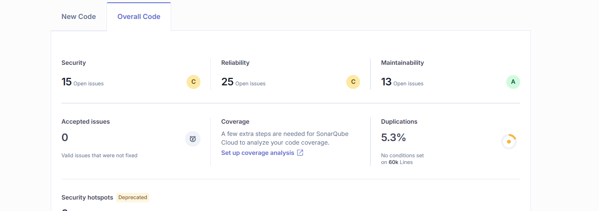

# Звіт про аналіз якості коду в SonarCloud (YourPathUkma)

**Проєкт:** YourPathUkma (REST API + вебфронтенд)
**Відповідальні ролі:** Quality Lead
**Інструмент:** SonarCloud (проєкт `ukma-fin-ssdm-2026_YourPathUkma`)
**Станом на:** 2026-11-05 (стан «до» рефакторингу, Overall Code)
**Версія / коміт аналізу:** TODO

> Шаблон звіту. Значення `TODO` потрібно заповнити за даними з SonarCloud;
> у цьому файлі їх не вигадано.

## 1. Загальна інформація

| Параметр | Значення |
|---|---|
| Репозиторій | ukma-fin-ssdm-2026/YourPathUkma |
| Гілка / PR аналізу | `main` (вкладка Overall Code) |
| Дата аналізу | 2026-11-05 (дата зняття метрик з панелі) |
| Quality Gate | TODO (Passed / Failed) |
| Кількість рядків коду (LoC) | ≈ 60k (за підписом біля Duplications на панелі; враховано згенерований звіт покриття) |

## 2. Підсумок за категоріями

| Категорія | Кількість проблем | Рейтинг (A–E) | Висновок |
|---|---|---|---|
| Security | 15 (панель); у таблиці нижче 14 зі старішого знімка | C | Усі проблеми в CI/CD workflow; 1 Blocker (script injection) |
| Reliability | 25 (панель); у таблиці нижче 28 зі старішого знімка | C | 1 Blocker (CORS); 21 проблема у згенерованому звіті покриття |
| Maintainability | 13 (панель); у таблиці нижче 7 зі старішого знімка | A | 4 Blocker; 3 з них у згенерованому JS-звіті покриття |
| Duplications | 5.3 % | — | 46 файлів, 3170 дубльованих рядків; 41 файлів — згенерований звіт покриття |

Додатково: Accepted issues — 0; Coverage — не налаштовано в SonarQube Cloud (панель пропонує «Set up coverage analysis»); Security Hotspots — TODO (значення не видно на скриншоті); Technical Debt — TODO (на скриншоті не показано).

**Знімок «до» з панелі SonarQube Cloud (Overall Code, 2026-11-05):**

| Показник | Значення «до» | Рейтинг |
|---|---|---|
| Security | 15 open issues | C |
| Reliability | 25 open issues | C |
| Maintainability | 13 open issues | A |
| Duplications | 5.3 % (≈ 60k рядків) | — |
| Accepted issues | 0 | — |

> Кількості на панелі (15 / 25 / 13) відрізняються від таблиць нижче (14 / 28 / 7): таблиці складено зі старішого знімка. Зі статусів видно, що виправлено три Reliability-проблеми (CORS, `preferences.py`, `deanery.py`: 28 → 25), що збігається з панеллю; зростання Security і Maintainability пояснюється новими проблемами в коді, доданому після того знімка. Конкретні нові проблеми слід звірити в списку Issues на панелі.

**Скриншот панелі «до» (Overall Code, 2026-11-05):**

## 3. Security

**Показники:** проблем Security — 14 (Blocker 1, High 1, Medium 12); Vulnerabilities — TODO; Security Hotspots (переглянуто / усього) — TODO; рейтинг — TODO.

**Результати аналізу:**

Усі 14 проблем категорії Security стосуються CI/CD-конфігурації (`.github/workflows/`), коду застосунку вони не зачіпають. За severity: Blocker — 1, High — 1, Medium — 12. Найкритичніша — ін'єкція скрипта через `inputs.paths` у `mutation.yml`. Решта — незафіксовані версії залежностей, встановлення без `--only-binary :all:` / `--ignore-scripts` та action без фіксації за SHA. Орієнтовна трудомісткість за оцінкою Sonar: 1 год на ін'єкцію, по 30 хв на SHA, PASSWORD і `--ignore-scripts`, по 1 год на кожну з решти.

| # | Файл | Правило | Severity | Опис | Рішення | Статус |
|---|---|---|---|---|---|---|
| 1 | `.github/workflows/mutation.yml` L36 | script injection (CWE) | Blocker | `inputs.paths` потрапляє напряму в `run`; значення задає той, хто запускає workflow | Передати вираз через змінну середовища (`env:`) і використовувати її в `run` | Fixed: `inputs.paths` передається через `env: MUTATE_PATHS`, у `run` використано `"$MUTATE_PATHS"` (PR #168) |
| 2 | `.github/workflows/deploy-api-docs.yml` L37 | full commit SHA (CWE) | High | Залежність підключена не за повним SHA коміту | Зафіксувати action за повним SHA коміту | Open |
| 3 | `.github/workflows/ci.yaml` L21 | hard-coded credential (CWE) | Medium | Виявлено «PASSWORD», можливий захардкоджений секрет | Перевірити, що це не реальний секрет; за потреби винести в GitHub Secrets | Open |
| 4 | `.github/workflows/ci.yaml` L38 | pip: `--only-binary :all:` (CWE) | Medium | Відсутність `--only-binary :all:` дозволяє виконання setup-скриптів | Додати `--only-binary :all:` або підтвердити безпечність | Open |
| 5 | `.github/workflows/ci.yaml` L38 | незафіксовані залежності | Medium | Залежності без зафіксованих версій | Зафіксувати версії (lock-файл / `==`) | Open |
| 6 | `.github/workflows/ci.yaml` L40 | pip: `--only-binary :all:` (CWE) | Medium | Відсутність `--only-binary :all:` дозволяє виконання setup-скриптів | Додати `--only-binary :all:` або підтвердити безпечність | Open |
| 7 | `.github/workflows/ci.yaml` L40 | незафіксовані залежності | Medium | Залежності без зафіксованих версій | Зафіксувати версії (lock-файл / `==`) | Open |
| 8 | `.github/workflows/ci.yaml` L42 | pip: `--only-binary :all:` (CWE) | Medium | Відсутність `--only-binary :all:` дозволяє виконання setup-скриптів | Додати `--only-binary :all:` або підтвердити безпечність | Open |
| 9 | `.github/workflows/ci.yaml` L42 | незафіксовані залежності | Medium | Залежності без зафіксованих версій | Зафіксувати версії (lock-файл / `==`) | Open |
| 10 | `.github/workflows/ci.yaml` L70 | npm: `--ignore-scripts` (CWE) | Medium | Без `--ignore-scripts` під час встановлення пакетів запускаються lifecycle-скрипти | Додати `--ignore-scripts` | Open |
| 11 | `.github/workflows/deploy-api-docs.yml` L31 | pip: `--only-binary :all:` (CWE) | Medium | Відсутність `--only-binary :all:` дозволяє виконання setup-скриптів | Додати `--only-binary :all:` або підтвердити безпечність | Open |
| 12 | `.github/workflows/deploy-api-docs.yml` L31 | незафіксовані залежності | Medium | Залежності без зафіксованих версій | Зафіксувати версії (lock-файл / `==`) | Open |
| 13 | `.github/workflows/mutation.yml` L30 | pip: `--only-binary :all:` (CWE) | Medium | Відсутність `--only-binary :all:` дозволяє виконання setup-скриптів | Додати `--only-binary :all:` або підтвердити безпечність | Open |
| 14 | `.github/workflows/mutation.yml` L30 | незафіксовані залежності | Medium | Залежності без зафіксованих версій | Зафіксувати версії (lock-файл / `==`) | Open |

## 4. Reliability

**Показники:** проблем Reliability — 28 (Blocker 1, High 2, Medium 25); Bugs — TODO; рейтинг — TODO.

**Результати аналізу:**

Знайдено 28 проблем Reliability: Blocker — 1, High — 2, Medium — 25. Три найсерйозніші — у коді бекенда (`main.py`, `deanery.py`, `preferences.py`), вони також враховані в Maintainability. Ще 21 проблема (доступність `<label>`/`<th>`, `isNaN`, `parseInt`) стосується згенерованого звіту покриття в `docs/testing/coverage/`, який краще виключити з аналізу Sonar. Решта: регулярні вирази з backtracking у `pkce.ts` і `download.ts` (по 20 хв), `multipart.ts` та `pytest.raises` у тесті. Схожі проблеми в таблиці згруповано за файлом; кількість окремих проблем вказано в описі.

| # | Файл | Правило | Severity | Опис | Рішення | Статус |
|---|---|---|---|---|---|---|
| 1 | `src/api/main.py` L113 | cors, configuration | Blocker | `CORSMiddleware` додано не останнім у ланцюжку middleware (також Maintainability, Blocker) | Додавати `CORSMiddleware` останнім | Fixed: `CORSMiddleware` додається останнім, після `RequestIdMiddleware` (PR #171; перевірено в коді `main`) |
| 2 | `src/api/routes/deanery.py` L49 | pydantic, type-hint | High | Необов'язкове поле без явного значення за замовчуванням (також Maintainability, High) | Додати `= None` | Fixed: у `DeaneryDocumentResponse` додано `= None` для `parse_error` (PR #170) |
| 3 | `src/api/routes/preferences.py` L59 | pydantic, type-hint | High | Необов'язкове поле без явного значення за замовчуванням (також Maintainability, High) | Додати `= None` | Fixed: у `PreferencesResponse` додано `= None` для `certificate_program_id` (PR #171; перевірено в коді `main`) |
| 4 | `frontend/src/auth/pkce.ts` L5 | regex, performance | Medium | Регулярний вираз із супер-лінійною складністю через backtracking (20 хв) | Спростити регулярний вираз | Fixed: Виправлено в гілці `refactor/sonar-report-fixes` (`ebaa831`); підтвердить аналіз після мерджу |
| 5 | `frontend/src/lib/download.ts` L5 | regex, performance | Medium | Регулярний вираз із супер-лінійною складністю через backtracking (20 хв) | Спростити регулярний вираз | Fixed: Виправлено в гілці `refactor/sonar-report-fixes` (`ebaa831`); підтвердить аналіз після мерджу |
| 6 | `frontend/src/test/multipart.ts` L7 | type-dependent | Medium | Причина відхилення Promise не є `Error` | Відхиляти Promise з `new Error(...)` | Fixed: Виправлено в гілці `refactor/sonar-report-fixes` (`f90af3f`); підтвердить аналіз після мерджу |
| 7 | `tests/test_free_elective_remaining.py` (L19) | pytest, tests | Medium | Виняток перевіряється не через контекстний менеджер (також Maintainability, Medium) | Використати `with pytest.raises(...)` | Fixed: Виправлено в гілці `refactor/sonar-report-fixes` (`1603686`); підтвердить аналіз після мерджу |
| 8 | `docs/testing/coverage/class_index.html` L47 | accessibility, wcag2-a | Medium | Поле вводу без пов'язаного `<label>` | Додати `<label>` до поля | Виключено з аналізу в `.sonarcloud.properties` (`4a57173`); ефект з'явиться після мерджу й нового аналізу |
| 9 | `docs/testing/coverage/class_index.html` L80, L85, L89 | accessibility, wcag2-a | Medium | Тег `<th>` без атрибута `id` або `scope` (3 шт.) | Додати `scope` або `id` | Виключено з аналізу в `.sonarcloud.properties` (`4a57173`); ефект з'явиться після мерджу й нового аналізу |
| 10 | `docs/testing/coverage/function_index.html` L47 | accessibility, wcag2-a | Medium | Поле вводу без пов'язаного `<label>` | Додати `<label>` до поля | Виключено з аналізу в `.sonarcloud.properties` (`4a57173`); ефект з'явиться після мерджу й нового аналізу |
| 11 | `docs/testing/coverage/function_index.html` L80, L85, L89 | accessibility, wcag2-a | Medium | Тег `<th>` без атрибута `id` або `scope` (3 шт.) | Додати `scope` або `id` | Виключено з аналізу в `.sonarcloud.properties` (`4a57173`); ефект з'явиться після мерджу й нового аналізу |
| 12 | `docs/testing/coverage/index.html` L46 | accessibility, wcag2-a | Medium | Поле вводу без пов'язаного `<label>` | Додати `<label>` до поля | Виключено з аналізу в `.sonarcloud.properties` (`4a57173`); ефект з'явиться після мерджу й нового аналізу |
| 13 | `docs/testing/coverage/index.html` L77, L82, L86 | accessibility, wcag2-a | Medium | Тег `<th>` без атрибута `id` або `scope` (3 шт.) | Додати `scope` або `id` | Виключено з аналізу в `.sonarcloud.properties` (`4a57173`); ефект з'явиться після мерджу й нового аналізу |
| 14 | `docs/testing/coverage/coverage_html_cb_c6c441fc.js` L53 | convention | Medium | `isNaN` замість `Number.isNaN` (2 проблеми на одному рядку; також Maintainability, Low) | Замінити на `Number.isNaN` | Виключено з аналізу в `.sonarcloud.properties` (`4a57173`); ефект з'явиться після мерджу й нового аналізу |
| 15 | `docs/testing/coverage/coverage_html_cb_c6c441fc.js` L203, L204, L207, L324, L556, L576, L671 | convention | Medium | `parseInt` замість `Number.parseInt` (7 шт.; також Maintainability, Low) | Замінити на `Number.parseInt` | Виключено з аналізу в `.sonarcloud.properties` (`4a57173`); ефект з'явиться після мерджу й нового аналізу |

## 5. Maintainability

**Показники:** проблем Maintainability — 7 (Blocker 4, High 2, Medium 1); Code Smells — TODO; Technical Debt — TODO; Debt Ratio — TODO %; рейтинг — TODO.

**Результати аналізу:**

Знайдено 7 проблем Maintainability: Blocker — 4, High — 2, Medium — 1. Чотири з них (CORS у `main.py`, значення за замовчуванням у `deanery.py` і `preferences.py`, `pytest.raises`) одночасно належать до Reliability. Ще три Blocker — неоголошені змінні в згенерованому `coverage_html_cb_*.js` (звіт покриття в `docs/testing/coverage/`); цей файл генерується інструментом покриття, тож його краще виключити з аналізу Sonar, а не правити вручну. Усі проблеми мають оцінку трудомісткості 2–5 хв.

| # | Файл | Правило | Severity | Опис | Рішення | Статус |
|---|---|---|---|---|---|---|
| 1 | `src/api/main.py` L113 | cors, configuration | Blocker | `CORSMiddleware` додано не останнім у ланцюжку middleware (також Reliability, Blocker) | Додавати `CORSMiddleware` останнім | Fixed: див. Reliability №1 (PR #171) |
| 2 | `src/api/routes/deanery.py` L49 | pydantic, type-hint | High | Необов'язкове поле без явного значення за замовчуванням (також Reliability, High) | Додати явне значення за замовчуванням (`= None`) | Fixed: у `DeaneryDocumentResponse` додано `= None` для `parse_error` (PR #170) |
| 3 | `src/api/routes/preferences.py` L59 | pydantic, type-hint | High | Необов'язкове поле без явного значення за замовчуванням (також Reliability, High) | Додати явне значення за замовчуванням (`= None`) | Fixed: див. Reliability №3 (PR #171) |
| 4 | `tests/test_free_elective_remaining.py` L19 | pytest, tests | Medium | Виняток перевіряється не через контекстний менеджер (також Reliability, Medium) | Обгорнути код, що кидає виняток, у `with pytest.raises(...)` | Fixed: Виправлено в гілці `refactor/sonar-report-fixes` (`1603686`); підтвердить аналіз після мерджу |
| 5 | `docs/testing/coverage/coverage_html_cb_c6c441fc.js` L166 | pitfall | Blocker | Змінна `cell` оголошена без `let`/`const`/`var` | Додати `let` / `const` / `var` | Виключено з аналізу в `.sonarcloud.properties` (`4a57173`); ефект з'явиться після мерджу й нового аналізу |
| 6 | `docs/testing/coverage/coverage_html_cb_c6c441fc.js` L358 | pitfall | Blocker | Змінна `cls` оголошена без `let`/`const`/`var` | Додати `let` / `const` / `var` | Виключено з аналізу в `.sonarcloud.properties` (`4a57173`); ефект з'явиться після мерджу й нового аналізу |
| 7 | `docs/testing/coverage/coverage_html_cb_c6c441fc.js` (рядок не вказано) | pitfall | Blocker | Змінна `key` оголошена без `let`/`const`/`var` | Додати `let` / `const` / `var` | Виключено з аналізу в `.sonarcloud.properties` (`4a57173`); ефект з'явиться після мерджу й нового аналізу |

## 6. Duplications

**Показники:** файлів з дублюванням — 46; дубльованих рядків — 3170; Duplicated Lines Density — TODO %; Duplicated Blocks — TODO; Duplicated Files — TODO.

**Результати аналізу:**

Sonar показує дублювання у 46 файлах, усього 3170 дубльованих рядків. З них 41 файлів (3069 рядків) — згенерований звіт покриття в `docs/testing/coverage/`; його варто виключити з аналізу, після чого дублювання у цих файлах зникне. Реальний код — 5 файлів фронтенду (101 рядків): тести та моки, де дублюються повторювані блоки. Відсоток дублювання по всьому проєкту у вставці не наведено. Згенеровані файли згруповано в один рядок таблиці.

| # | Файли з дублюванням | Дубльовані рядки (%) | Кількість рядків | Опис | План усунення | Статус |
|---|---|---|---|---|---|---|
| 1 | `docs/testing/coverage/*.html` (41 файлів, згенерований звіт покриття) | 7.5–71.0 % | 3069 | Дублюється типова розмітка HTML-звіту (найбільше в `__init__.py`-сторінках: 71,0 %; у `index.html` — 36,7 %, 243 рядки) | Виключити `docs/testing/coverage/` з аналізу Sonar (`sonar.exclusions`) або не комітити згенерований звіт | Виключено з аналізу в `.sonarcloud.properties` (`4a57173`); ефект з'явиться після мерджу й нового аналізу |
| 2 | `frontend/src/auth/login.test.ts` | 18.2 % | 27 | Повторювані блоки в тесті | Винести спільний код у допоміжну функцію / фікстуру | Fixed: Виправлено в гілці `refactor/sonar-report-fixes` (`8c0ce5a`, `it.each`); точний блок Sonar звірити після аналізу |
| 3 | `frontend/src/features/plan-view/export.test.tsx` | 14.9 % | 14 | Повторювані блоки в тесті | Винести спільний код у допоміжну функцію / фікстуру | Fixed: Виправлено в гілці `refactor/sonar-report-fixes` (`e828997`) |
| 4 | `frontend/src/mocks/core.ts` | 7.8 % | 23 | Повторюваний код у мок-даних | Винести спільний код у допоміжну функцію / фікстуру | Fixed: Виправлено в гілці `refactor/sonar-report-fixes` (`49f0422`) |
| 5 | `frontend/src/test/handlers.ts` | 7.1 % | 23 | Повторюваний код в MSW-хендлерах | Винести спільний код у допоміжну функцію / фікстуру | Fixed: Виправлено в гілці `refactor/sonar-report-fixes` (`49f0422`) |
| 6 | `frontend/src/features/plan-view/view.test.tsx` | 6.8 % | 14 | Повторювані блоки в тесті | Винести спільний код у допоміжну функцію / фікстуру | Fixed: Виправлено в гілці `refactor/sonar-report-fixes` (`e828997`) |

## 7. Висновки та план рефакторингу

**Обрані метрики (3 з 5, Security фіксується окремо):** Duplicated Lines (%) — 5.3 % «до»; Reliability Rating — C «до»; Code Smells / кількість проблем Maintainability — 13 «до». Maintainability Rating вже A, тож для нього відстежуємо кількість проблем, а не рівень. Значення «після» буде внесено після мерджу PR і нового аналізу `main` (TODO).

**Security Rating: C «до».** Усі проблеми Security попереднього знімка стосуються CI/CD (`.github/workflows/`): незафіксовані залежності, `pip` без `--only-binary :all:`, `npm` без `--ignore-scripts`, action без закріплення за SHA. Код застосунку вони не зачіпають. У межах цієї лабораторної їх не рефакторимо (це конфігурація CI, а не структура коду), тож очікуємо, що Security Rating лишиться C. План виправлення — окремий PR аналітика безпеки (зв'язок зі `static-analysis.md` Лаб 5 і `threat-model.md` Лаб 3).

### Запахи й рефакторинги

| # | Запах (джерело в звіті) | Техніка | Файли | Коміт |
|---|---|---|---|---|
| 1 | Дубльований блок імітації завантаження файлу (Duplications №3, №6) | Extract Method | `export.test.tsx`, `view.test.tsx`, новий `test/downloads.ts` | `e828997` |
| 2 | Дубльоване тіло відповіді `/config` (Duplications №4, №5) | Extract Method + спільне джерело | `mocks/core.ts`, `test/handlers.ts`, `mocks/fixtures.ts` | `49f0422` |
| 3 | Три однакові за структурою тести (Duplications №2) | Parametrize Test (`it.each`) | `auth/login.test.ts` | `8c0ce5a` |
| 4 | `pytest.raises` через lambda (Reliability №7, Maintainability №4) | Use Context Manager (ідіома `with pytest.raises`) | `tests/test_free_elective_remaining.py` | `1603686` |
| 5 | Promise відхиляється не `Error` (Reliability №6) | Replace Value With Error Object | `frontend/src/test/multipart.ts` | `f90af3f` |
| 6 | Regex з backtracking (Reliability №4, №5) | Substitute Algorithm | `lib/download.ts`, `auth/pkce.ts` | `ebaa831` |
| 7 | Згенерований звіт покриття (Duplications №1, Reliability №8–15, Maintainability №5–7) | не рефакторинг коду, а зміна області аналізу | `.sonarcloud.properties` | `4a57173` |

### Для кожного рефакторингу: що лишається незмінним, що змінюється, який тест це доводить

**1. Extract Method: `mockDownloads()`.**
- *Незмінне:* поведінка тестів `export.test.tsx` і `view.test.tsx`: той самий стаб `URL.createObjectURL`, той самий перехоплений `click` по `<a download>`, масив `saved` скидається перед кожним тестом, spy відновлюється після.
- *Змінюється в структурі:* 14 однакових рядків з двох файлів винесено в `src/test/downloads.ts`, обидва файли викликають `const saved = mockDownloads()`.
- *Доказ:* `export.test.tsx` і `view.test.tsx` (16 тестів) проходять до й після; вони перевіряють імена збережених файлів у `saved`.

**2. Extract Method: `configFixture(features)`.**
- *Незмінне:* JSON-відповідь `GET /config`: для dev-моків `saz_sync: true`, для тестів `false`, усі інші поля ті самі. Імпорти `configFixture` з `test/handlers` у ~20 тестах не змінились (ре-експорт).
- *Змінюється в структурі:* 23 дубльовані рядки замінено одним джерелом у `mocks/fixtures.ts`; `core.ts` викликає `configFixture({ saz_sync: true })`.
- *Доказ:* `mocks/core.test.ts`, `mocks/handlers.test.ts` і всі тести, що використовують `configHandler` (повний прогін: 49 файлів зелені).

**3. Parametrize Test: `it.each` у `login.test.ts`.**
- *Незмінне:* три сценарії відхилення (чужий `state`, `error` від Microsoft, немає `code`), очікувані коди `OAUTH_STATE_MISMATCH` / `OAUTH_ERROR` / `OAUTH_MISSING_CODE` і те, що запиту до API не було.
- *Змінюється в структурі:* три копії тіла тесту замінено таблицею випадків і одним тілом.
- *Доказ:* `login.test.ts`: 12 тестів зелені до й після; кожен випадок лишився окремим тестом.

**4. Use Context Manager: `with pytest.raises`.**
- *Незмінне:* перевіряється, що `free_elective_remaining(-1)` кидає `ValueError`.
- *Змінюється:* виклик у lambda замінено блоком `with`; це ідіоматична форма, яку вимагає правило Sonar.
- *Доказ:* `tests/test_free_elective_remaining.py` (4 тести) зелені.

**5. Replace Value With Error Object: `multipart.ts`.**
- *Незмінне:* `readBytes` резолвить `Uint8Array`, на успішному шляху нічого не змінилось.
- *Змінюється:* у `reader.onerror` відхилення йде з `reader.error ?? new Error(...)`, а не з потенційним `null`.
- *Доказ:* `multipart.test.ts` і всі тести завантаження файлів (повний прогін зелений). Шлях помилки окремо тестом не покрито: ризик низький, бо змінено лише значення причини відхилення.

**6. Substitute Algorithm: regex.**
- *Незмінне:* результат `parseDispositionFilename` для всіх підтримуваних форм заголовка (`filename*=UTF-8''…`, `filename="…"`, `filename=…`, null) і результат `randomUrlSafe` (base64url без доповнення). У `download.ts` змінений regex розпізнає ту саму мову (`\s*` перед `[^']*` був зайвим, бо `[^']*` уже охоплює пробіли). У `pkce.ts` `=` у base64 бувають лише як кінцеве доповнення, тож `/=/g` дає той самий результат, що й `/=+$/`.
- *Змінюється:* складність обробки «поганого» входу з квадратичної до лінійної. Виміри: 32 000 пробілів у заголовку — було ≈ 1043 мс, стало ≈ 0,1 мс. Для `pkce.ts` ризик теоретичний (у base64 максимум два `=`), виправлення потрібне для відповідності правилу Sonar.
- *Доказ:* нові тести `download.test.ts` (граничні випадки `filename*` і тест лінійності: до виправлення падав на 1222 мс при порозі 100 мс, після — зелений) і `pkce.test.ts` (довжина й відсутність `=` для 1, 2, 3, 16, 31, 32 байтів; вектор RFC 7636).

**7. Виключення згенерованого звіту покриття.** Це не рефакторинг, а зміна області аналізу: `docs/testing/coverage/**` додано до `sonar.exclusions` і `sonar.cpd.exclusions` у `.sonarcloud.properties`. Дублювання й проблеми Reliability/Maintainability у цих файлах зникнуть через зміну налаштувань, а не через покращення коду. У «після» це треба окремо зазначити, щоб не завищувати ефект рефакторингів.

### Регресійне тестування на гілці `refactor/sonar-report-fixes`
- `pytest -q`: 389 passed, 1 skipped.
- `vitest run`: 452 passed (49 файлів); було 443 до додавання тестів у п. 6.
- `tsc --noEmit` і `eslint .`: без помилок.
- Збоїв, що потребують документування, не було.

### Що не покращується в цій лабораторній
Проблеми Security (CI/CD) лишаються відкритими, Maintainability Rating уже A. Якщо Reliability Rating не зміниться, причину слід шукати серед нових проблем після останнього знімка (див. примітку в розділі 2).

## Використання ШІ

Структуру шаблону (шапка, розділи за категоріями) створено за допомогою Claude Code.
Фактичних даних SonarCloud файл не містить; перевірка — лише перегляд структури.

Статуси `src/api/main.py` L113 і `src/api/routes/preferences.py` L59 оновлено за допомогою Claude Code. Перевірено через API SonarCloud (2026-10-30): аналіз PR #171 (коміт `d263e9a`) — Quality Gate OK, 0 нових проблем; на `main` (аналіз `0b62882`, до виправлень) обидві проблеми ще відкриті, тож остаточно вони закриються після мерджу й нового аналізу.
Статус «Fixed» для пункту 1 розділу Security (script injection у `mutation.yml`) додано за допомогою Claude Code; перевірка — перегляд диффу, нового аналізу SonarCloud ще не було.
Статус «Fixed» для `deanery.py` (Reliability 2, Maintainability 2) додано за допомогою Claude Code; перевірка — перегляд диффу PR #170, нового аналізу SonarCloud ще не було. Метрики «до» (розділ 2) внесено зі скриншота панелі SonarQube Cloud, наданого учасником команди; статуси `Fixed` для CORS і `preferences.py` оновлено за допомогою Claude Code (перевірено в коді `main` і за мерджами PR #168, #170, #171; фактичної верифікації окремих issues у Sonar не виконувалось).

### Рефакторинг із ШІ-агентом (Лаб 8)
- **Хто й що згенерував:** Claude Code (Anthropic) виконав рефакторинги 1–6 з розділу 7 у гілці `refactor/sonar-report-fixes`, змінив `.sonarcloud.properties` і додав тести (`download.test.ts`, `pkce.test.ts`).
- **Завдання агенту:** запах зі звіту → техніка → інваріант («зовнішня поведінка не змінюється, тести проходять після кожного кроку»); див. таблицю в розділі 7.
- **Як верифіковано:** кожен рефакторинг окремим комітом з повним прогоном тестів (результати в розділі 7); для regex — вимірювання часу на старому й новому коді та тест, що падав до виправлення (1222 мс при порозі 100 мс).
- **Перегляд людиною рядок за рядком:** TODO — підтвердити керівнику рефакторингу після перегляду `git diff main..HEAD`.
- **Метрики Sonar «після»:** TODO — після мерджу PR та нового аналізу.
